# Лабораторная работа №6. Система контроля версий

**Дисциплина:** Основы программирования

**Выполнил:** студент группы 4516 Каныгин К.К.

## Цель работы

Изучить базовые возможности системы управления версиями Git,
получить опыт работы с локальным и удалённым репозиторием.

## Ход работы

### 1. Создание аккаунта GitHub и Fork репозитория

Создан аккаунт на GitHub. Исходный репозиторий
https://github.com/Kurtyanik/LR6
скопирован в личное хранилище с помощью Fork.

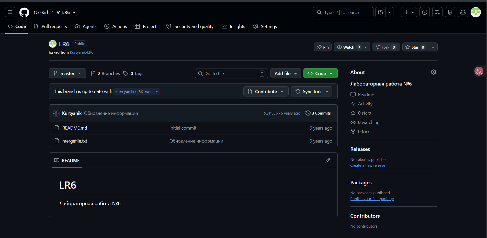

### 2. Установка и настройка Git

Установлен Git для Windows. Проверена версия программы.
Настроены имя пользователя и электронная почта.

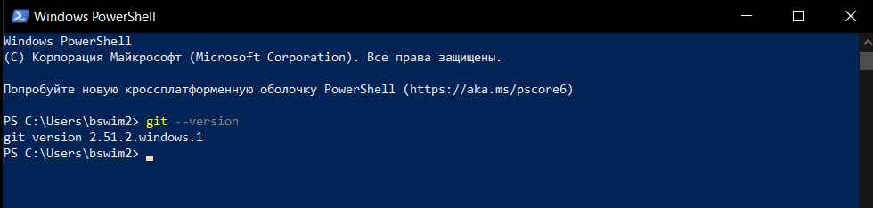

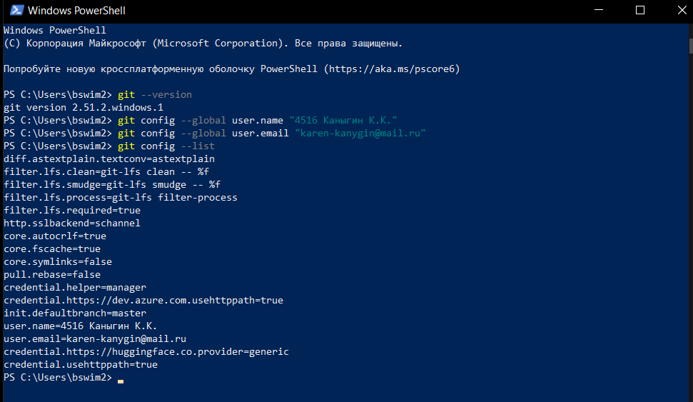

### 3. Клонирование удалённого репозитория

Личный удалённый репозиторий склонирован на компьютер
с помощью команды git clone.

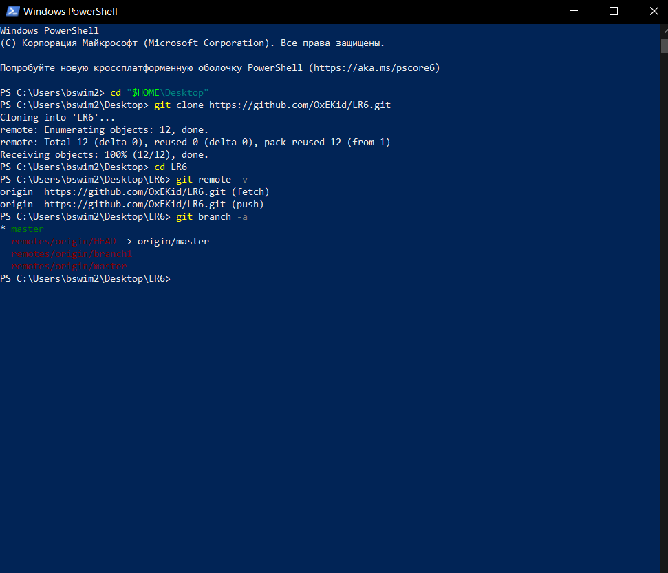

### 4. Добавление файла через GitHub

Через веб-интерфейс GitHub создан файл about.txt.
Изменения получены в локальный репозиторий с помощью git pull.

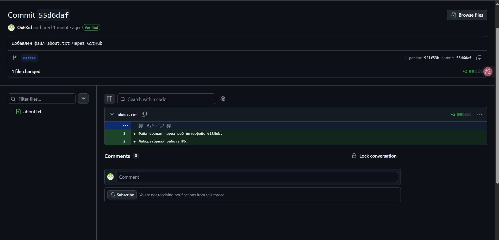

### 5. Получение истории операций для веток

Получена история изменений веток master и branch1.
Для просмотра истории использованы команды git log.

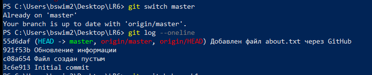

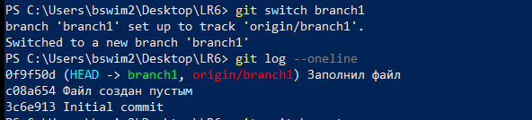

### 6. Просмотр последних изменений

С помощью git show просмотрен последний коммит.
Командой git diff выполнено сравнение двух веток.

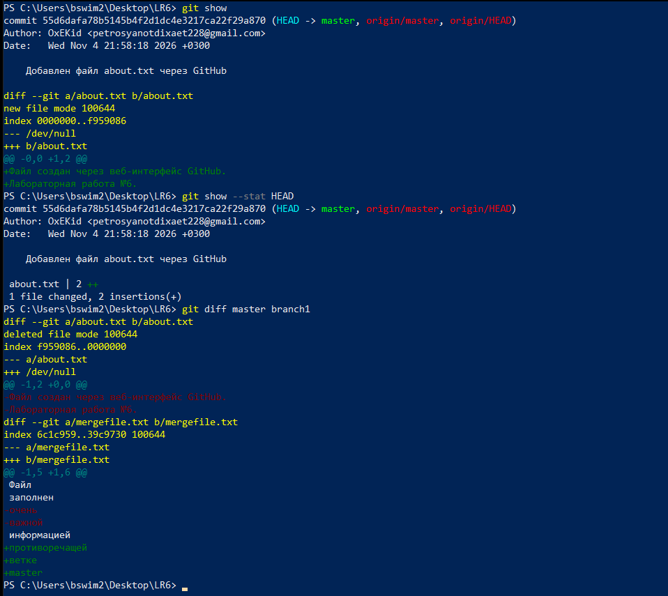

### 7. Слияние веток с разрешением конфликта

Выполнено слияние дополнительной ветки с master.
При слиянии обнаружен конфликт в файле mergefile.txt.
Конфликт разрешён вручную с сохранением необходимых изменений.

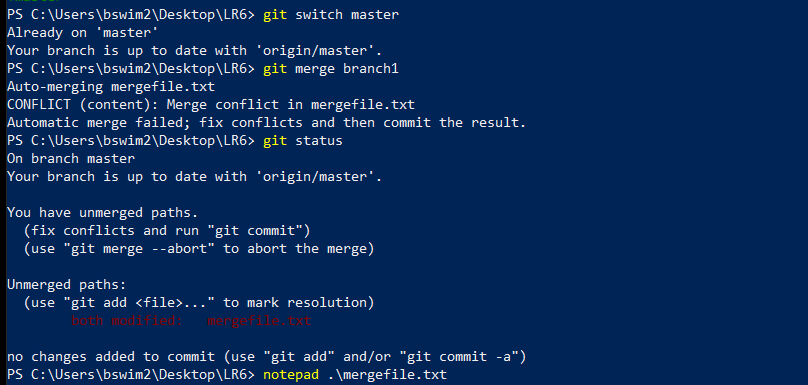

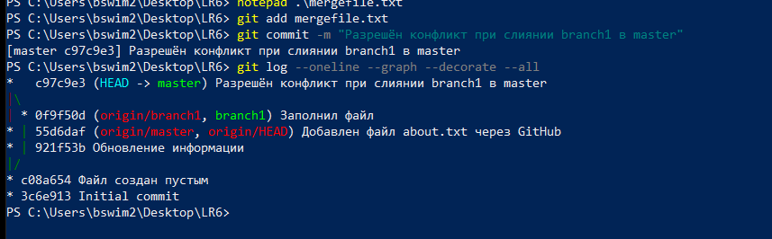

### 8. Удаление побочной ветки

После успешного слияния дополнительная ветка удалена.
Проверен список оставшихся локальных веток.

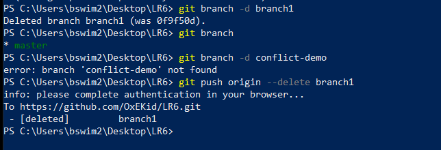

### 9. Создание нескольких коммитов

Создан файл notes.txt.
В него последовательно внесены изменения,
каждое из которых зафиксировано отдельным коммитом
с соответствующим комментарием.

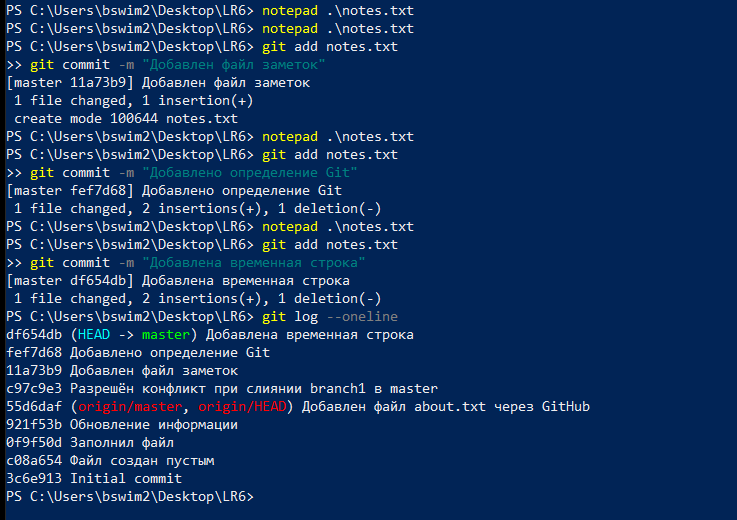

### 10. Откат коммита

Для отмены последнего изменения использована команда git revert.
Проверена история коммитов и содержимое файла notes.txt.

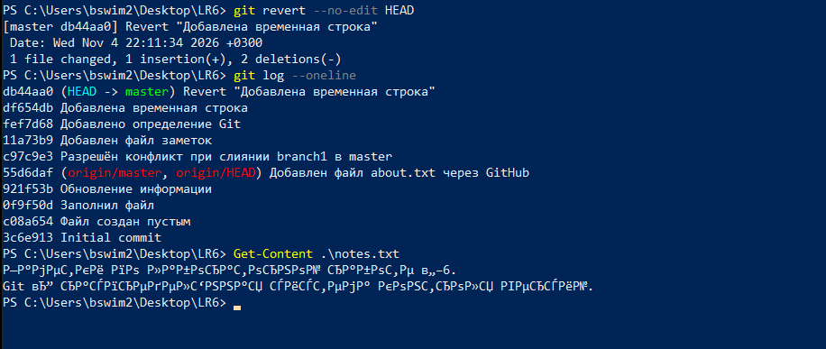

### 11. Создание ветки для отчёта

Для оформления отчёта создана отдельная ветка report.
Создана папка screenshots для хранения снимков экрана.
Отчёт подготовлен в формате Markdown.

### 12. Форматированная история операций

Получена история коммитов с указанием сокращённого хэша,
даты, автора и комментария.
История добавлена в настоящий отчёт.

## Лог команд

```powershell
git --version
git config --global user.name "4516 Каныгин К.К."
git config --global user.email "karen-kanygin@mail.ru"
git config --global core.quotepath false
git config --list
git clone https://github.com/OxEKid/LR6.git
cd LR6
git remote -v
git branch -a
git switch master
git pull origin master
git switch branch1
git log --oneline
git switch master
git log --oneline
git log --oneline --graph --decorate --all
git show
git diff master branch1
git merge branch1
git status
notepad .\mergefile.txt
git add mergefile.txt
git commit -m "Разрешён конфликт при слиянии branch1 в master"
git branch -d branch1
git branch
git add notes.txt
git commit -m "Добавлен файл заметок"
git commit -m "Добавлено определение Git"
git commit -m "Добавлена временная строка"
git revert --no-edit HEAD
git log --oneline -5
Get-Content .\notes.txt
git switch -c report
New-Item -ItemType Directory -Force screenshots
git add screenshots
git commit -m "Отчёт: добавлены снимки экрана"
git add README.md
git commit -m "Отчёт: подготовлена структура README"
git log --pretty=format:"%h | %ad | %an | %s" --date=format:"%d.%m.%Y %H:%M"
```

## Вывод

В ходе лабораторной работы были изучены основные возможности системы контроля версий Git.
Выполнены настройка Git, клонирование удалённого репозитория, получение изменений с GitHub, просмотр истории коммитов, работа с ветками, слияние с разрешением конфликта, создание нескольких коммитов и откат изменений.
Также подготовлен отчёт в формате Markdown с использованием снимков экрана и историей операций.

## История операций

```text
634d4de | 04.11.2026 22:20 | 4516 Каныгин К.К. | Отчёт: подготовлена структура README
171ec97 | 04.11.2026 22:16 | 4516 Каныгин К.К. | Отчёт: добавлены снимки экрана
db44aa0 | 04.11.2026 22:11 | 4516 Каныгин К.К. | Revert "Добавлена временная строка"
df654db | 04.11.2026 22:11 | 4516 Каныгин К.К. | Добавлена временная строка
fef7d68 | 04.11.2026 22:10 | 4516 Каныгин К.К. | Добавлено определение Git
11a73b9 | 04.11.2026 22:10 | 4516 Каныгин К.К. | Добавлен файл заметок
c97c9e3 | 04.11.2026 22:06 | 4516 Каныгин К.К. | Разрешён конфликт при слиянии branch1 в master
55d6daf | 04.11.2026 21:58 | OxEKid | Добавлен файл about.txt через GitHub
921f53b | 21.11.2020 20:09 | Kurtyanik | Обновление информации
0f9f50d | 21.11.2020 20:08 | Kurtyanik | Заполнил файл
c08a654 | 21.11.2020 20:02 | Kurtyanik | Файл создан пустым
3c6e913 | 21.11.2020 19:58 | Kurtyanik | Initial commit
```